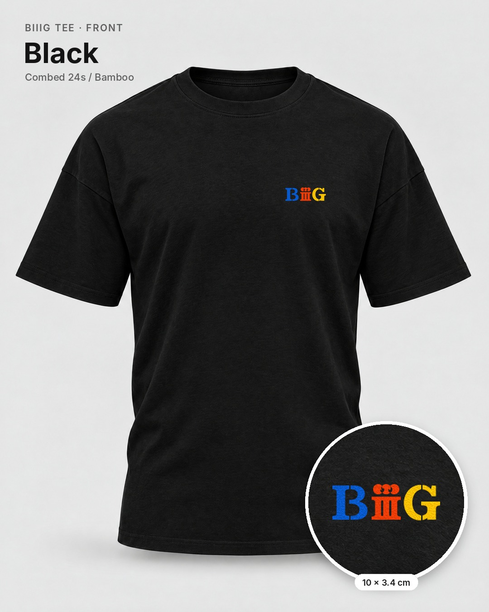
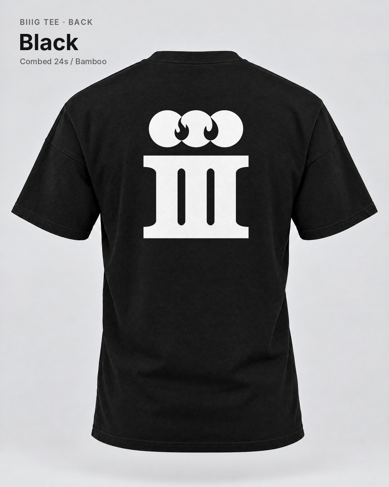
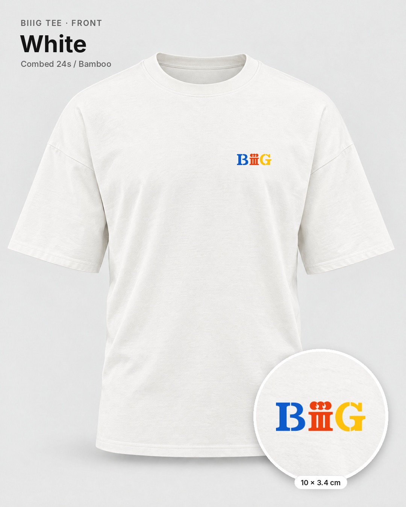
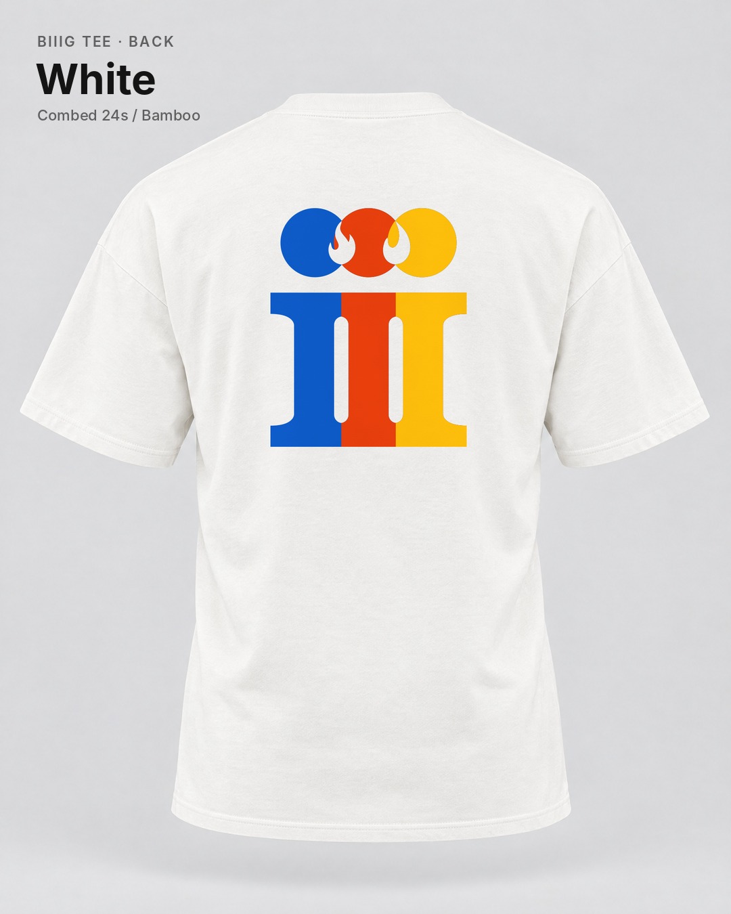

# BIIIG tee: ghost mannequin mockups

Four 1080×1350 mockups of the BIIIG design on the same ghost mannequin blanks
and in the same layout as the BIGBANG SG set (black and white, front and back).

| | |
|---|---|
|  |  |
|  |  |

## Sizes and placement

- **Front:** BIIIG emblem, 10 × 3.4 cm, on the wearer's left chest. Top edge
  18 cm below the collar seam, left edge 10 cm from the centre line. Three
  inks (blue, red, yellow) on both shirt colours.
- **Back:** III, 32 × 38.9 cm, centred, top edge 15 cm below the collar seam.
  The back is 2.3 cm taller than the BIGBANG back (32 × 36.6 cm), so check
  that the vendor's print area fits it.
  - **Black tee:** white ink (`print/back-iii.svg`).
  - **White tee:** the front's three inks, left to right: blue `#0756C6`,
    red `#E73A07` and yellow `#FDBB05` (`print/back-iii_white-tee.svg`).
    Each circle is one colour, overlapping left over right, so the flames
    sit in red and yellow. The III is cut through its two slots into
    blue, red and yellow columns. The colours butt together with no gap.
- On the white tee, the flame cut-outs and slots show the white shirt.

## How they're made

`build_mockups.py` draws the real print SVGs onto the blanks, adds the shirt's
folds and texture, and adds the label and the zoom circle on the fronts. It
uses no AI, so the artwork in the mockups is exactly the print file.

- `blanks/`: the Higgsfield ghost mannequin blanks (GPT Image 2.5, Oct 21),
  the same ones the BIGBANG set used.
- `print/`: the print files. `front-biiig.svg` and `back-iii.svg` are the
  clean rebuilds from `../vector-rebuild/` (the original traces had small
  bumps). `back-iii_white-tee.svg` is the three-colour back that this
  script writes.

To rebuild, run `pip install cairosvg pillow numpy`, then
`python3 build_mockups.py blanks print <out_dir>`. To change the sizes or
placement, set any of `FRONT_W_CM`, `FRONT_TOP_CM`, `FRONT_IN_CM`,
`BACK_W_CM` or `BACK_TOP_CM` as environment variables. Set
`WHITE_BACK=mono` for a plain black back on the white tee.
