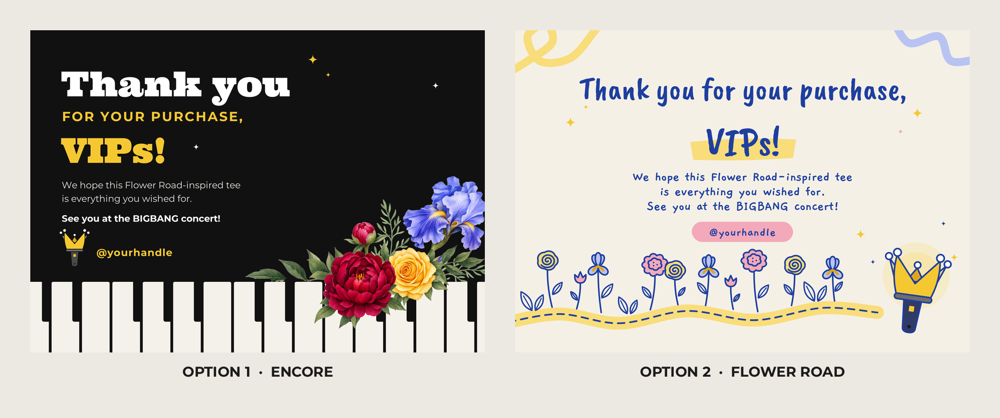

# Thank-you card: BIGBANG Flower Road tee

A thank-you card for buyers of the Floral B tee (the Flower Road one: watercolour flowers around a slab B on the front, the BIGBANG wordmark over piano keys on the back). Front only for now, in two options.



| | Option 1 · Encore | Option 2 · Flower Road |
|---|---|---|
| Look | Black card in the tee's colour, with lightstick yellow. Big Ultra headline (the font from the tee's BIGBANG wordmark). The tee's watercolour iris, peony and rose sit on a row of piano keys, echoing the back print | Cream card with cobalt ink, closer to your four thank-you references. Hand-lettered headline, a line-drawn road of roses, peonies and irises, and a road that ends at a lit-up crown lightstick ("see you at the concert") |
| Print | Full colour, includes two embedded watercolour images | All vector |

## Size

- **A6 landscape**: 148 × 105 mm trim.
- **3 mm bleed** on every side, so each file's artboard is **154 × 111 mm**. Trim 3 mm in from every edge.
- Keep text and the handle at least 5 mm inside the trim (the safe area). The `*_bleed.png` previews show the trim line in pink and the safe area dashed in blue.
- To go bigger (e.g. A5, 210 × 148 mm, which is the same ratio): change `TRIM_W`, `TRIM_H` in `src/build.py` and scale the positions, or scale the artwork 141.9 % in Illustrator.

## Files

| File | What it is |
|---|---|
| `illustrator/option-1_encore_A6.ai` / `.svg` | Option 1, editable |
| `illustrator/option-2_flower-road_A6.ai` / `.svg` | Option 2, editable |
| `preview/option-*_A6.png` | 300 dpi preview at trim size, i.e. what the printed card looks like |
| `preview/option-*_A6_bleed.png` | Same with bleed, plus trim and safe-area guides |
| `preview/options-side-by-side.png` | The two options together |
| `src/build.py` | Builds everything. The `SETTINGS` block at the top holds the size, bleed, handle, copy and colours |
| `src/assets/` | The tee's watercolour flowers, cut into two pieces (iris spray, peony + rose) |
| `fonts/` | The fonts the cards use |

## Editing in Illustrator

1. **Install the fonts in `fonts/` first** (double-click each file, then Install). The text is **live**, not outlined, so the handle and copy stay editable. All four fonts are free Google Fonts:
   - **Ultra**: Option 1 headline (also the tee's B and wordmark)
   - **Montserrat** Regular and Bold: Option 1's "FOR YOUR PURCHASE," line, body and handle
   - **Caveat Brush**: Option 2 headline
   - **Gaegu** Bold: Option 2 body and handle
2. **Open the `.svg`** if you want named groups: *Background*, *Piano keys*, *Flowers*, *Headline*, *Body copy*, *Instagram handle*, *Crown lightstick* and so on. In Illustrator they arrive as sub-layers. **Or open the `.ai`**. It's PDF-compatible, so Illustrator opens it directly, but everything comes in as groups on one layer. Either way, do **File → Save As → Adobe Illustrator (.ai)** once to make it a native file.
3. **Swap the handle**: select the `@yourhandle` text and type the real one. In Option 2, resize the pink pill if the handle is much longer.
4. **Before printing**: set **File → Document Setup → Bleed** to 3 mm and resize the artboard to 148 × 105 mm, centred (Artboard tool, Shift+O). The art already runs 3 mm past it. Or just export at 154 × 111 mm and tell the printer it includes 3 mm bleed.
5. Colours are RGB. Convert to CMYK (**Edit → Edit Colors → Convert to CMYK**) if your printer asks for it. The yellow `#F5C832` and the cobalt `#1E3FA0` are worth a printed proof.

## Copy

Light grammar fix of the original, as approved:

> **Thank you for your purchase, VIPs!**
> We hope this Flower Road-inspired tee is everything you wished for.
> See you at the BIGBANG concert!
> @yourhandle

## Regenerate

```
pip install cairosvg pillow
# install the fonts in fonts/ so cairo can find them (e.g. copy to ~/.fonts and run fc-cache -f)
python3 src/build.py
```

## Credits and notes

- The watercolour flowers come from the Floral B tee artwork (branch `claude/brave-edison-i18pzh`, `tshirt-bigbang-sg/`). They were generated with AI image models for that shirt.
- The crown lightstick, line flowers, piano keys and doodles are drawn in code for this card. They're inspired by the references, not traced.
- Fonts: Ultra (Apache 2.0, licence in `fonts/`). Montserrat, Caveat Brush and Gaegu are under the SIL Open Font License 1.1 (Montserrat's copy is in `fonts/`).
- "BIGBANG" and the crown lightstick are the group's / YG's marks. This card is fan merch packaging, so keep it to a thank-you insert. Don't present it as official merchandise.
