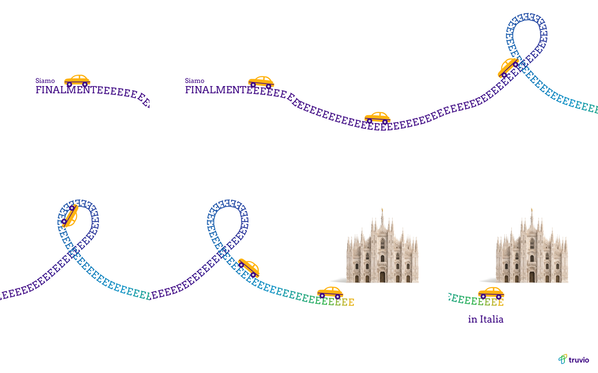
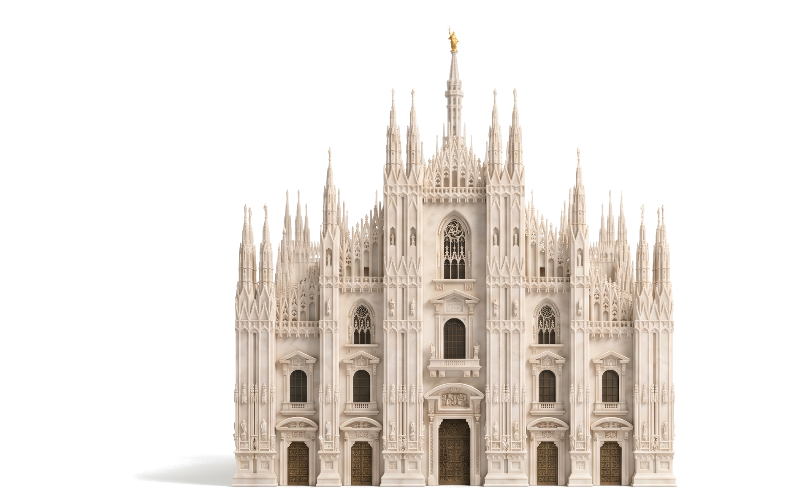

# Handoff: Siamo finalmente in Italia (Italy market entry)

24 to 25 Oct 2026. Work by Grady with Claude. Repo folder: `truvio/italy-market-entry/finally-film/` on branch `claude/clever-hopper-kwrk4j` (grxu/grxu).

Reader: a new Claude session that builds the film natively in After Effects on Grady's Mac.

## Where it stands
- The layout and timing are locked. The animatic (`animatic.mp4`, 12.7s) is the reference for every frame of the AE build.
- The Duomo di Milano image is generated, cleaned and placed (`plates/duomo-plate.png`).
- Nothing exists in After Effects yet. Every shape, letter and car position is exported as data in `ae/ae-data.json`, so the build doesn't have to be eyeballed.
- The animatic uses stand-ins: Arvo for Museo Slab and a violet logo reconstructed from the white SVG. The Italian copy hasn't had a native check.
- Nothing is blocking the AE build.

## Next steps
1. **Claude (new session):** get the folder onto the Mac. Pull branch `claude/clever-hopper-kwrk4j` of grxu/grxu, or unzip `finally-film-handoff.zip`. Play `animatic.mp4` and read this file.
2. **Claude:** build the AE project from `ae/ae-data.json`, following "How to edit" below. Set the type in Museo Slab 500, which is installed on Grady's Mac.
3. **Claude:** render a 1080x1350 H.264 MP4 at 25fps and check it against `animatic.mp4` frame by frame at the times in the storyboard table.
4. **Grady:** check the Italian copy with a native speaker, and swap in the official colour logo if one exists.
5. **Grady:** send the render to the digital team for sign-off, then post it as a single LinkedIn organic video.

## Open items

| Item | Who | Why it matters |
|---|---|---|
| Native check of "Siamo finalmente in Italia" | Grady | It's the only copy in the film. A slip in Italian is the first thing an Italian audience will notice. |
| Sign-off before posting | Digital team | They run the LinkedIn page. |
| Posting date | unknown, ask Grady | No date set yet. |
| Official colour logo | unknown, ask Grady | The animatic uses `assets/truvio-logo-violet.svg`, the official white SVG with the wordmark recoloured Deep Violet. Swap in the official colour lockup if one exists. |
| Sound | unknown, ask Grady | Nothing planned. LinkedIn autoplays muted, so the film has to work silent either way. |
| Duomo shadow | Grady to judge | The model's shadow falls to the left of its base. It grounds the model, but it may want softening in AE. |
| Gold E's on white | Grady to judge | The last few E's under the Duomo are Yellow Gold (#FFB310) on white. That's light at 70px. Check it on a phone. |

## Copy (final, from the brief)
- On screen: "Siamo" / "FINALMENTEEEE..." (the trailing E's become the road) / "in Italia"
- In English: "We are finally in Italy."
- No URL and no product line. The end is brand-only: "in Italia" plus the logo.
- The post caption hasn't been written.

## Decisions

Grady chose (24 Oct 2026):
- **Format:** one LinkedIn organic post with one video, as a remake of the "We are finallyyyy on Flipkart" letter-road reference (four clips Grady supplied).
- **One MP4, 4:5, 1080x1350, one continuous take, no swipe effect, with the reference pacing (2.5s, 2.5s, 4.2s, 3.5s).** LinkedIn organic posts don't swipe between videos. GIFs were tested as an idea and dropped: PDF carousel pages don't animate, a post with several images shows as a grid, and a GIF's 256 colours band the gradient.
- **Follow the reference layout closely, with no map of Italy.** v1 (commit `96a42f6`) traced the outline of Italy, Sicily and Sardinia in E's. Grady rejected it in favour of the reference layout.
- **Italian headline in caps:** "Siamo FINALMENTEEEE ... in Italia". Caps E's read like track rungs, the way the reference's Y's do.
- **Middle of the film:** a wave, then the loop, as in the reference.
- **Brand-only end:** no URL.
- **Car:** a small flat car, Yellow Gold body with Deep Violet wheels and trim, kept as is. It's generic and not modelled on any real car.
- **Darker road:** mostly Deep Violet and Celestial Blue, with green and gold as short accents.
- **Destination:** an Italian landmark made in Higgsfield, replacing the Flipkart storefront. Grady chose the Duomo di Milano (Milan is Italy's business and finance capital), as a soft 3D miniature, straight-on facade.
- **v2 animatic locked** (25 Oct).

Claude's calls (not reviewed yet):
- **One loop, not a row of loops.** The reference has exactly one loop in its third clip, so v2 has one. The car rides the inside and goes upside down at the top.
- **Camera:** each panel holds still like a reference slide, then pans 0.7s with an ease to the next as the car crosses the edge (at 2.5s, 5.0s and 9.2s).
- **Gradient stops along the road:** Deep Violet 0 to 40 percent, Celestial Blue by 86, Electric Green by 95, Yellow Gold at the end.
- **Type weight:** regular (Museo Slab 500), to match the reference's light slab. Arvo 400 stands in for it.
- **E spacing:** 10 percent looser than the font's own advance, like the reference's Y's.
- **Ground:** pure white rather than the reference's cream, for the brand's white space.
- **End layout:** "in Italia" right-aligned to the road end (as "On Flipkart" is), fading in at 10.6s. The logo sits bottom right inside the 65px margin and fades in at 11.1s.
- **Duomo take:** Claude generated two takes (Grady asked for a batch of 2) and picked A2 over A1. A1's ground went grey with dark corners and its marble looked waxy.
- **Duomo clean-up:** the ground was lifted to white, cropped to 950:595 and feathered to white outside the model. It's placed with a Multiply blend.

## What was made

The full film as eight key frames (Arvo and the reconstructed logo are stand-ins):

The end frame. The road ends under the Duomo, the car parks at the road end, then "in Italia" and the logo:

The loop, with the car upside down at the top:

The Duomo image, take A2 after clean-up:

## Files

| File | What it is |
|---|---|
| `animatic.mp4` | The 12.7s animatic at 25fps. The timing and layout reference for the build. Uses stand-ins. |
| `storyboard.md` | The beat-by-beat storyboard with measurements and colour notes. |
| `storyboard/` | Eight key frames (`frame-00.0s.png` to `frame-12.7s.png`) and `contact-sheet.png`. |
| `ae/ae-data.json` | The build data: headline positions, all 89 E's (x, y, rotation, fill), the road path, the car's position and rotation for every frame (319 frames at 25fps), the camera pan per frame, and the Duomo, "in Italia" and logo placements. Generated, don't edit by hand. |
| `ae/road.svg` | The road's centre line (the E's baseline) as one open path, 4320x1350. |
| `ae/car.svg` | The flat car at 1x (74 x 34), origin on the ground line between the wheels. Final artwork. |
| `plates/duomo-plate.png` | The cleaned Duomo image, 1900 x 1190 (2x the 950 x 595 slot). Final. |
| `plates/duomo-a2.png` | The raw Higgsfield render (take A2), 2528 x 1696. Source, for a transparent cutout. |
| `assets/truvio-logo-violet.svg` | The logo used in the animatic. Stand-in until the official colour lockup turns up. |
| `higgsfield-prompt-duomo-plate.md` | The Higgsfield prompt, settings and notes on both takes. |
| `film.html` | The animatic page. It's the source of truth for the geometry and timing. |
| `render.js` | Renders the key frames and the animatic frames from `film.html` with Playwright. |
| `export-ae.js` | Regenerates everything in `ae/` from `film.html`. |

## How to edit

### Rules to keep
- Match `animatic.mp4`. The layout and timing are locked, so change only what the open items or Grady ask for.
- Brand: Deep Violet #400685, Celestial Blue #008FC4, Electric Green #2DB34A, Yellow Gold #FFB310 on white #FFFFFF. Museo Slab for all type. Keep the 65px safe margin on the final frame.
- Never generate or distort the logo. Never use the name "Dynamo".
- Ask Grady with the AskUserQuestion tool. Never ask in plain chat (see `CLAUDE.md`, repo path).

### Build it in After Effects
All coordinates are px in a 4320x1350 world (four 1080x1350 panels side by side). Panel k starts at x = 1080k. Read every number from `ae/ae-data.json`.

1. **Comps.** Make a "Panorama" comp at 4320x1350, 25fps, 12.7s, on a white solid. Then make a "Film" comp at 1080x1350 with Panorama nested inside it.
2. **Camera.** In Film, set Panorama's anchor to 0,0 and keyframe its position x to minus `frames[].camX` (y stays 0). Or use easy-ease pans of 0.7s centred on 2.5s, 5.0s and 9.2s, which gives the same move.
3. **Headline.** "Siamo" at x 256, baseline y 600, 46px. "FINALMENT" at x 256, baseline y 675, 70px. Both Museo Slab 500, Deep Violet.
   - The road starts where the word ends: `headline.headEndX` = 694.6 with Arvo. Museo Slab sets a different width. Adjust the word's tracking until it ends at x 695, so the road keeps its shape.
4. **Road.** Make one text layer per entry in `letters[]`: a capital "E", Museo Slab 500, 70px, centre-aligned, anchor on the baseline, at (x, y), rotated `rot` degrees, filled with `fill`. A script that loops over the array is quickest.
   - Precompose the 89 layers as "Road".
   - Text on a path from `ae/road.svg` works too, but the gradient needs a fill animator per colour band. The per-letter layers match the animatic exactly.
5. **Car.** Bring `ae/car.svg` in through Illustrator, then use Create Shapes from Vector Layer. Set the anchor to the ground line between the wheels (the SVG origin) and scale it 260%.
   - Keyframe position and rotation from `frames[].car` (x, y, rotation in degrees), one key per frame.
   - The car sits on top of the E's: the data already lifts it 48px above the baseline. It goes upside down at the top of the loop, as intended.
6. **Duomo.** Import `plates/duomo-plate.png`. Place it at x 3305, y 120 (top left), scale 50% so it fills 950 x 595, and set the blend mode to Multiply.
7. **End.** "in Italia": Museo Slab 500, 70px, Deep Violet, right-aligned with its right edge at x 3640, baseline y 985. Opacity 0 to 100 from 10.6s to 11.1s.
   - Logo: 220px wide, top left at x 4035, y 1212. Opacity 0 to 100 from 11.1s to 11.6s.
8. **Render.** Film comp, H.264 MP4, 1080x1350, 25fps.

### Re-render the animatic or the data (repo, cloud or any machine with Node and Playwright)
- `node render.js frames storyboard 0.0 1.5 3.8 6.0 7.4 8.4 10.0 12.7` re-renders the key frames.
- `node render.js video <dir> 25` renders the frame sequence. Then run `ffmpeg -framerate 25 -i <dir>/f%04d.png -c:v libx264 -pix_fmt yuv420p -crf 18 animatic.mp4`.
- `node export-ae.js` rewrites `ae/`.
- Open `film.html?t=6.0` in a browser to hold any frame.

## QA results
- End frame (12.7s): all ink sits inside x 0 to 1014 and y 150 to 1284. The right and bottom edges are inside the 65px margin. The road enters from the left edge by design.
- Logo: moved from x 4055 to 4035 during the handoff. It had crossed the right margin by 20px.
- Duomo ground: A1 sampled #D7D7D7 at the corners and A2 #F8F8F8. After clean-up all four plate corners sample #FFFFFF, and no plate edge shows in the end frame.
- Animatic: 12.76s at 25fps, 319 frames.
- Road: 89 E's along 4,764px of path.

## Session log
- 24 Oct: Grady shared the four reference clips and asked for a Truvio version for the Italy market entry. Three directions were pitched: the boot, autostrada and the loop. Grady picked the boot, Italian, brand-only. (`06f146a`)
- 24 Oct: The format was settled as one MP4. Swiping between videos and the GIF workaround were checked and dropped.
- 24 Oct: v1 storyboard and animatic, tracing the outline of Italy in e's. (`96a42f6`) Grady rejected the map.
- 24 Oct: v2 rebuilt on the reference layout: caps, wave, loop, landmark, darker road. (`d62c70f`) Grady locked it.
- 24 Oct: Grady picked the Duomo, as a soft 3D miniature, straight-on. Prompt file written. (`8b66b62`)
- 24 Oct: Grady asked Claude to run it in Higgsfield as a batch of 2. Take A2 was cleaned and placed in the animatic. (`bb3d96b`)
- 25 Oct: Handoff. Added the `ae/` export, moved the logo inside the margin, and copied the logo into the folder.

## Related
- `truvio/italy-market-entry/italy-market-entry.md` (repo path): the Italy AP Automation warm-up posts (P1 to P4), same market entry. The Illustrator build there (`build_italy_variants.jsx`) is a model for an ExtendScript build.
- `CLAUDE.md` (repo path): Grady's working preferences and the decisions for this film.
- `.claude/skills/truvio-higgsfield-ad/` (repo path): the skill behind the Duomo prompt.
