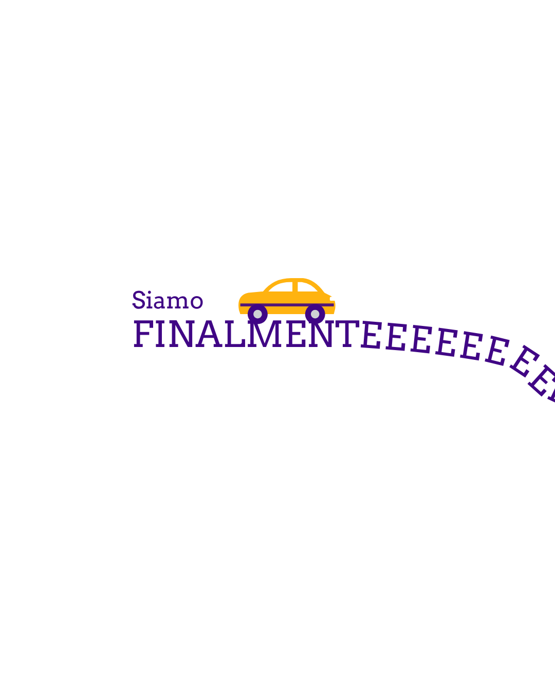
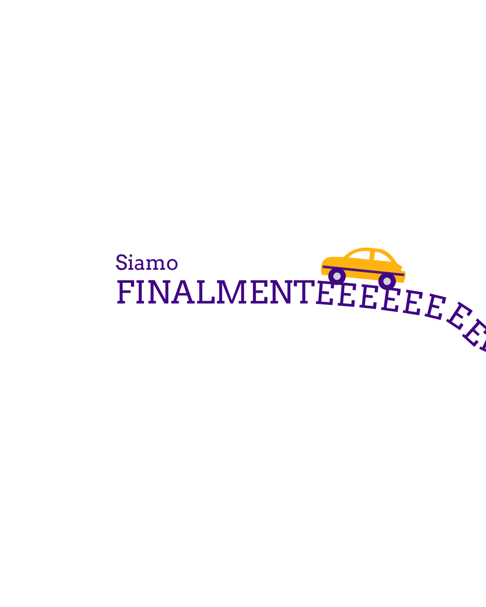
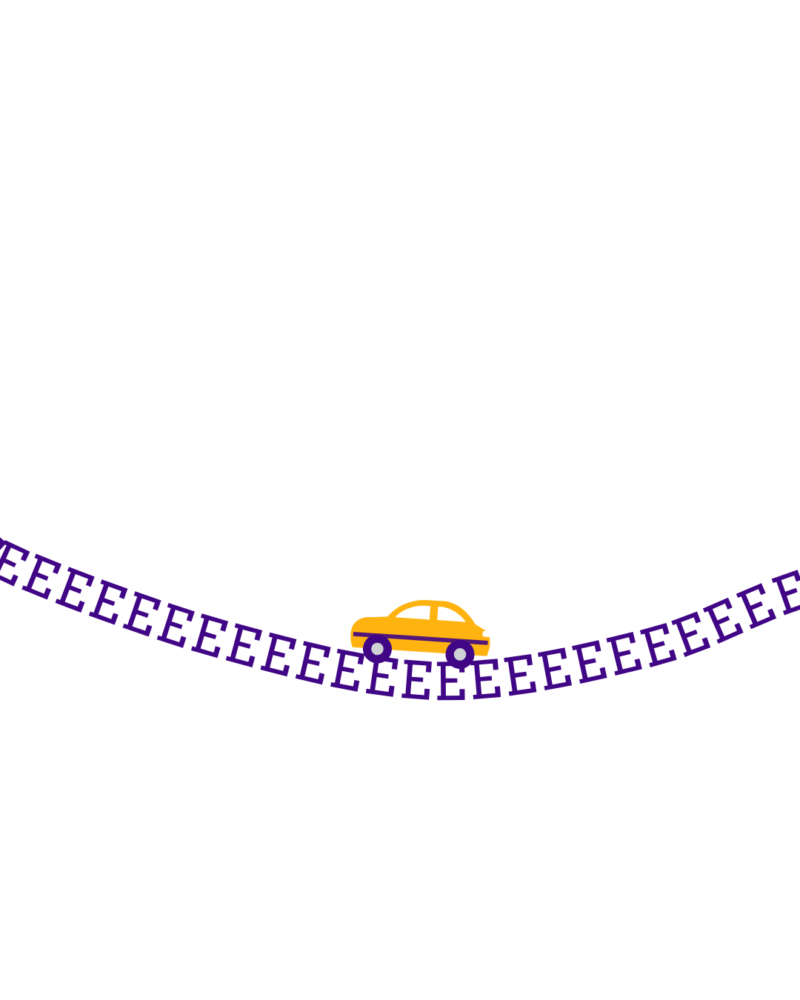
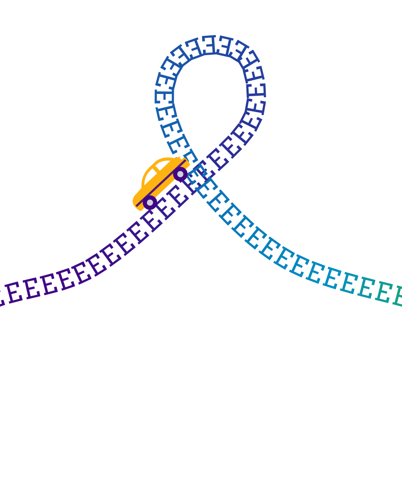
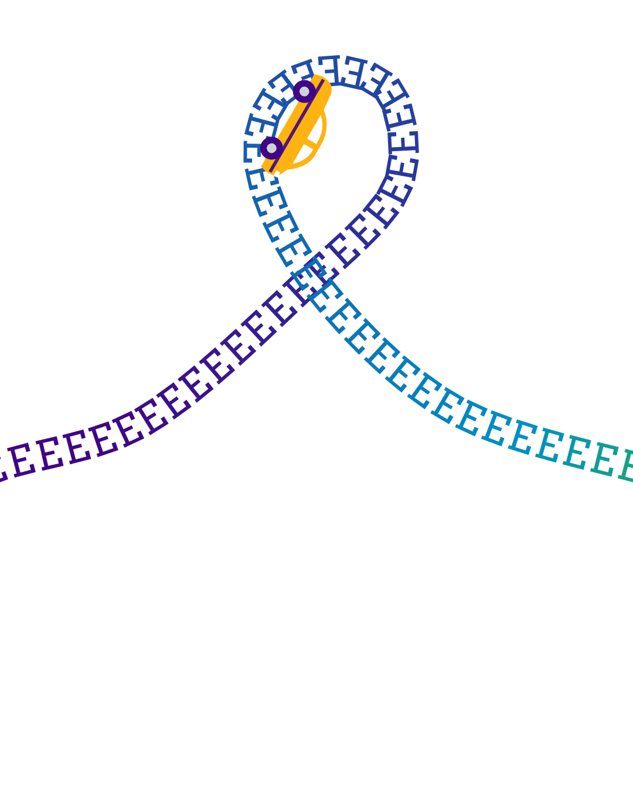
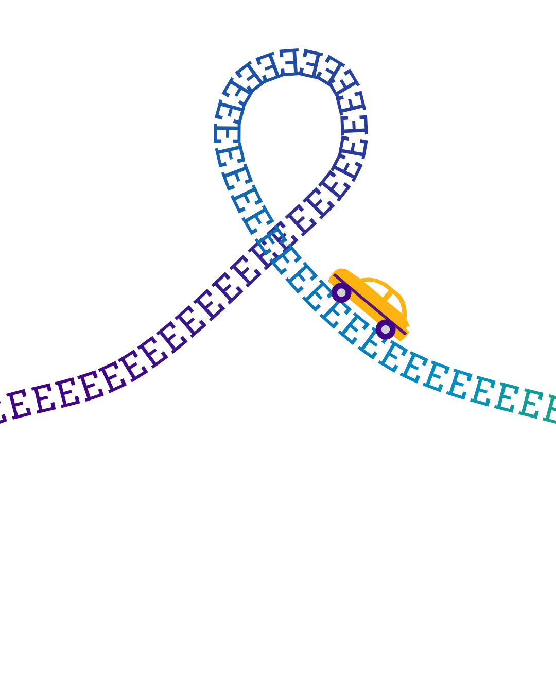
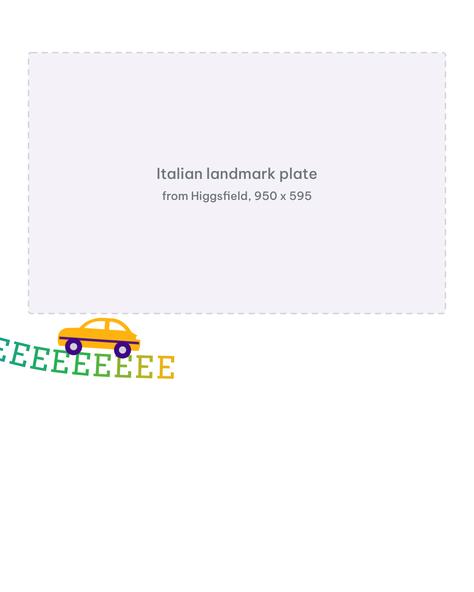
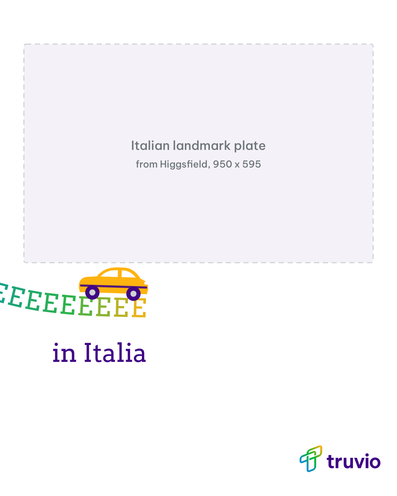

# Siamo finalmente in Italia: storyboard v2

One LinkedIn organic post. One MP4, 1080x1350 (4:5), 12.7s, one continuous take. It's a close remake of the "We are finallyyyy on Flipkart" letter-road format. v1 drew a map of Italy, and Grady dropped it. v2 follows the reference layout.

- Watch the timing: `animatic.mp4`. It's a rough render for pacing and layout only. Rebuild it in After Effects.
- All eight key frames: `storyboard/contact-sheet.png`.

## How the reference is built
- The four reference clips are one panorama cut into four panels. The road runs unbroken from panel to panel.
- Panel 1 holds the headline and tail, panel 2 a wave, panel 3 one coaster loop, and panel 4 the destination.
- Each panel holds still while the car drives across it.
- In our single MP4 the camera holds each panel the same way and pans 0.7s to the next one as the car crosses the edge.

## Frames

| Time | Frame | What happens |
|---|---|---|
| 0.0 to 2.5s |   | Panel 1. "Siamo / FINALMENTEEEE" is on screen from frame one. The car sits on the caps right of "Siamo", then rolls down the tail. |
| 2.5 to 5.0s |  | Panel 2. The road dips into a wave and climbs out. |
| 5.0 to 9.2s |    | Panel 3. The coaster loop. The car rides the inside of the loop and goes upside down at the top, like the reference. |
| 9.2 to 12.7s |   | Panel 4. The road runs under the landmark plate and the car parks at the road end. "in Italia" fades in at 10.6s, right-aligned to the road end. The logo follows at 11.1s. |

## Layout, measured off the reference
- Headline: "Siamo" 46px, baseline y 600. "FINALMENT" 70px caps, baseline y 675, x 256. Both are Deep Violet.
- Road: caps E's at 70px, spaced a little looser than the font, rotated along the path.
- Road height by panel: the tail leaves the word at y 675 and reaches y 783 at the panel edge. The wave bottoms out at y 945. The loop top sits at y 95. Panel 4 runs flat at y 864 and ends at x 400.
- Landmark plate: x 65 to 1015 and y 120 to 715 in panel 4 (950 x 595). It's a placeholder for the Higgsfield image.
- "in Italia": 70px, right-aligned to the road end at x 400, baseline y 985.
- Logo: 220px wide, bottom right of panel 4 on the 65px margin.
- Car: about 190px long, riding on top of the E's.

## Colour
- The darker road: Deep Violet for the first 40%, easing to Celestial Blue through the loop.
- Electric Green and Yellow Gold come in only over the last stretch under the landmark.

## After Effects build notes
- Build the road as one mask path across a 4320x1350 comp. Nest it in a 1080x1350 comp and keyframe the position: hold each panel, then pan 0.7s with easy ease at 2.5s, 5.0s and 9.2s.
- Use a text layer on the path for the E's, with a fill colour animator by index for the gradient.
- The car follows the same path with Auto-Orient on, offset about 48px above the baseline.
- Set "in Italia" and the logo by hand: Museo Slab 500 and the official lockup.

## Check before it goes out
- Fonts: the mocks use Arvo as a stand-in for Museo Slab. Set "Siamo", "FINALMENTE", the E's and "in Italia" in Museo Slab 500, to match the reference's regular weight.
- Italian copy: "Siamo finalmente in Italia" needs a native check.
- Landmark plate: generate it in Higgsfield on a clean white or near-white ground, so it sits on the page like the reference storefront. Keep text and logos out of the generated image. Set the logo by hand.
- Sound: LinkedIn autoplays muted, so the film has to work silent.

## Files
- `film.html`: the animatic. Open it to play the loop, or add `?t=3.6` to hold one frame.
- `render.js`: renders the key frames and the animatic sequence with Playwright. See the usage note at the top of the file.
- `storyboard/`: the eight key frames and the contact sheet.
- `animatic.mp4`: the 12.7s animatic at 25fps.
