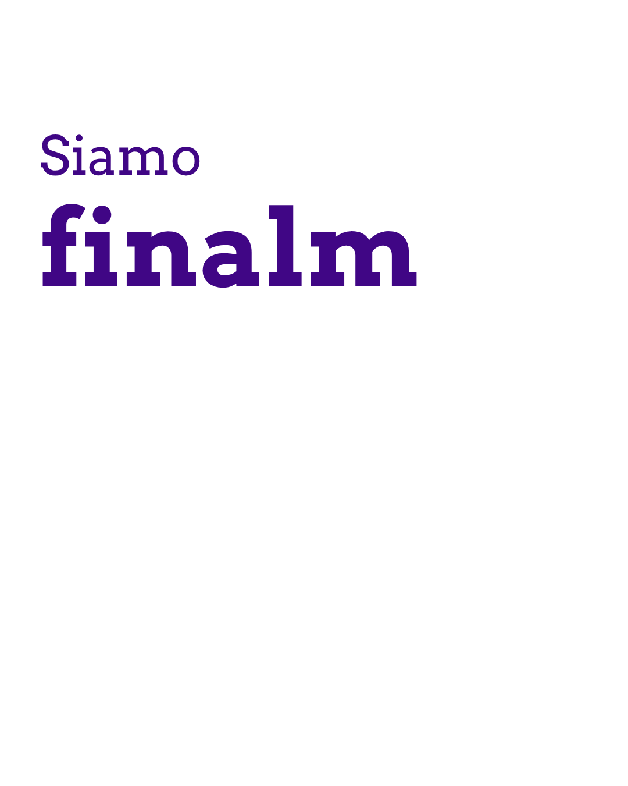
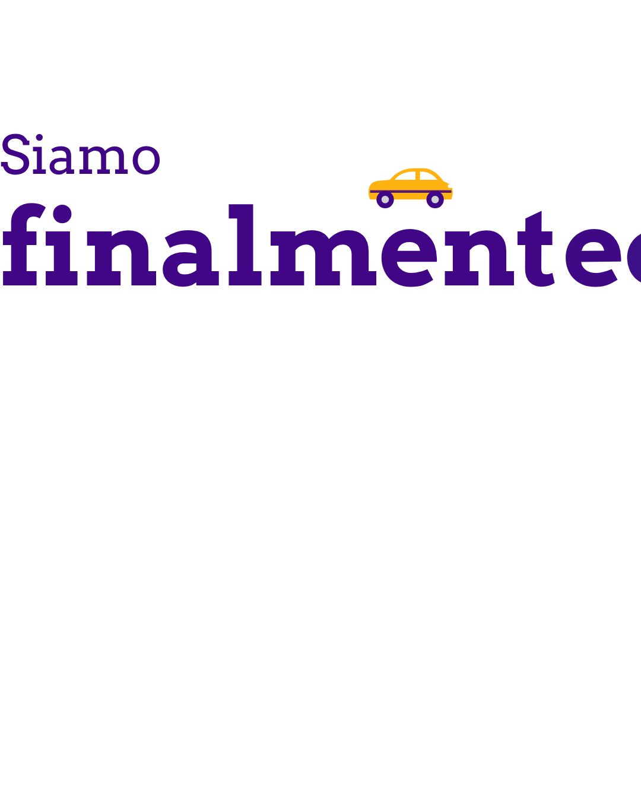
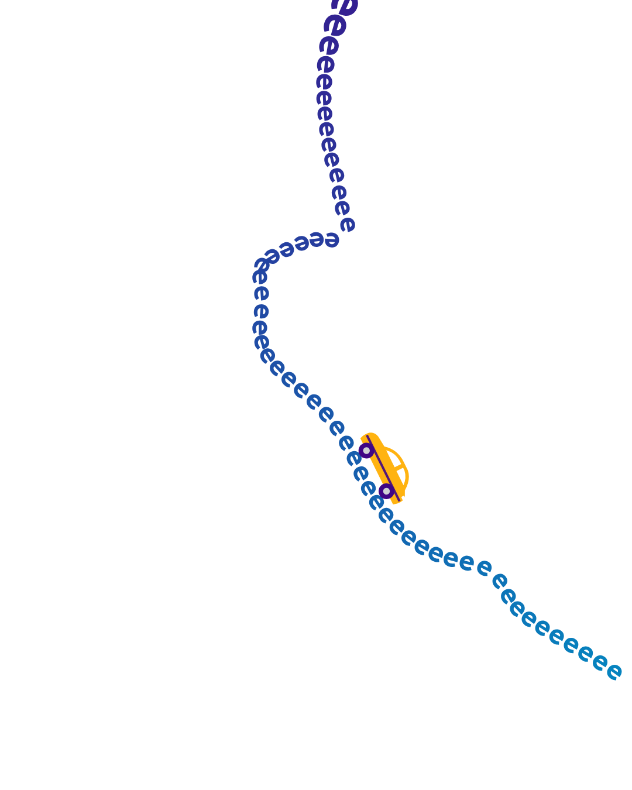
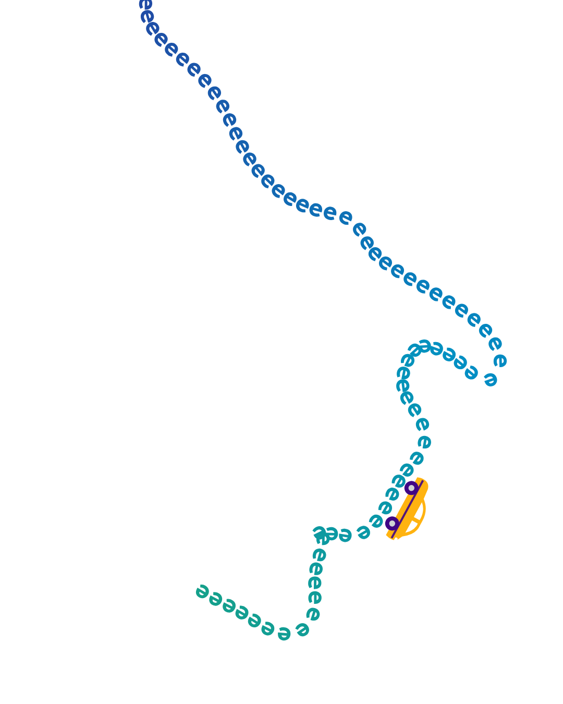
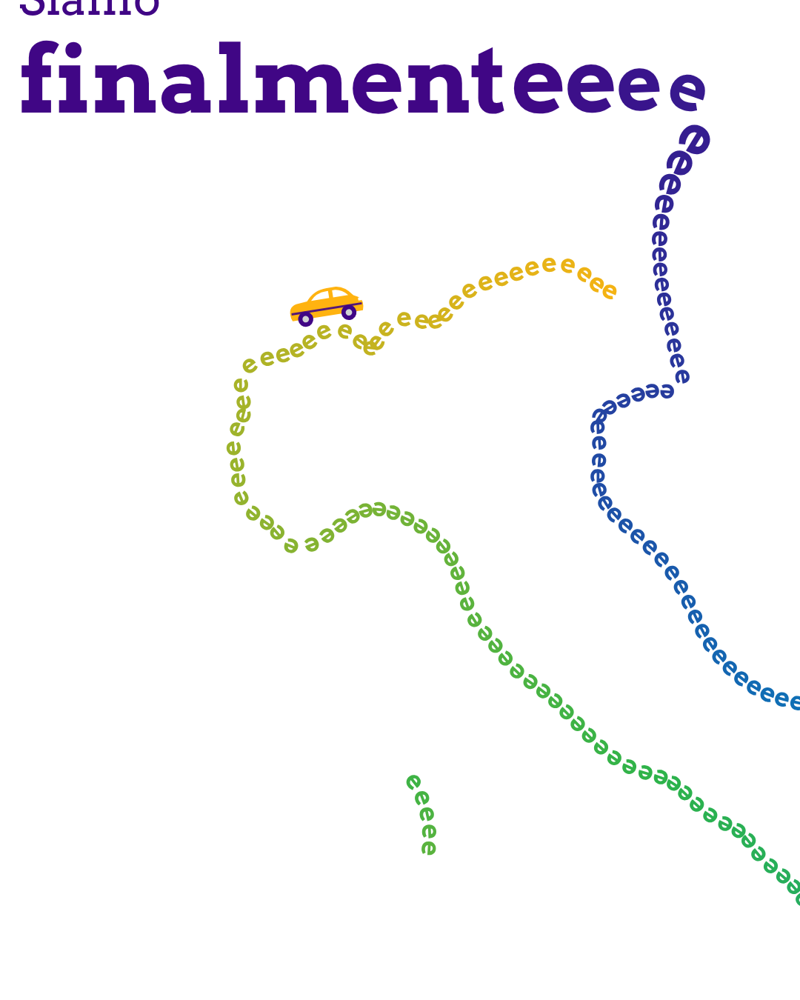

# Siamo finalmente in Italia: storyboard

One LinkedIn organic post. One MP4, 1080x1350 (4:5), 12.7s, one continuous take. It's a remake of the "We are finallyyyy on Flipkart" letter-road format. The trailing e's of "finalmente" become a road that draws the whole of Italy.

- Watch the timing: `animatic.mp4`. It's a rough render for pacing and layout only. Rebuild it in After Effects.
- All seven key frames side by side: `storyboard/contact-sheet.png`.

## Decisions so far
- Direction A, the boot. The letter road traces Italy, Sicily and Sardinia included.
- Italian headline: "Siamo finalmenteeee ... in Italia" (We are finally in Italy).
- Brand-only end card: the logo and "in Italia". No URL and no product line.
- The vehicle is a small flat car in brand colours. It is generic and not modelled on any real car.
- One take with no cuts and no swipe effect. The beats follow the reference pacing: 2.5s, 2.5s, 4.2s, 3.5s.

## Frames

| Time | Frame | What happens |
|---|---|---|
| 0.0 to 1.0s |  | "Siamo" fades in. "finalmente" types on in Deep Violet. The camera sits tight on the headline. |
| 1.0 to 2.5s |  | The car drops onto the word and rolls right. The e's spill out ahead of it and shrink as they run. |
| 2.5 to 4.6s |  | The tail swings down into the Tarvisio corner. The road runs past Venezia and down the Adriatic. The camera follows the car. |
| 4.6 to 5.8s |  | The road rounds the heel and the Gulf of Taranto, then runs down Calabria to the toe. |
| 5.8 to 8.4s |  | The loop. The road jumps the strait and laps Sicily once. The car hangs upside down on the south coast, like the reference loop. |
| 8.4 to 10.6s |  | The car runs up the west coast and across the Alps. The camera pulls back. Sardinia draws itself in as a closed ring. |
| 10.6 to 12.7s |  | The car parks on the Alps. "in Italia" rises in. The logo fades in at 11.2s. It holds for about 1.5s. |

## How the road works
- The road is one path: the headline baseline, the tail, then the mainland clockwise from Tarvisio. At the toe it loops round Sicily and comes back, then closes at Tarvisio.
- Running clockwise keeps every e standing on the sea side of the coast, and the car rides on top of the letters.
- Colour runs along the road in the primary gradient: Deep Violet at the headline, then Celestial Blue, Electric Green and Yellow Gold at the close. Sardinia sits in the green to gold end.
- Letter size: 92px in the headline, tapering to 26px by the Alps. It stays 26px round the coast.
- The outline comes from Natural Earth 1:50m (public domain), smoothed so no bend is tighter than a letter. To rebuild it, run `source/make_road.py`.

## After Effects build notes
- Build the road as one mask path on a shape layer. Paste the points from `road.js`, or trace them in Illustrator.
- Use a text layer on the path for the e's, with a text animator for reveal, size taper and fill colour by index.
- The car follows the same path with Auto-Orient on, offset above the letters.
- The camera is a 2D null for position and scale. It starts at 200%, holds near 180% while it follows the car, and eases out to 100% from 8.5s to 10.6s.
- Set the end card by hand: "in Italia" in Museo Slab 500 and the official logo lockup.

## Check before it goes out
- Fonts: the mocks use Arvo as a stand-in for Museo Slab. "finalmente" is set in Museo Slab 700, and "Siamo" and "in Italia" in 500.
- Yellow Gold e's on white are light at 26px. Check them on a phone. If they wash out, end the gradient at Electric Green or set the Alps stretch a size larger.
- Italian copy: "Siamo finalmente in Italia" needs a native check.
- Logo: the mock uses `assets/truvio-logo-violet.svg`. Swap in the official colour lockup if one exists.
- Sound: nothing is planned yet. A short engine or tyre sound under the loop would land the joke on autoplay with sound on. LinkedIn autoplays muted, so the film has to work silent.

## Files
- `film.html`: the animatic. Open it to play the loop, or add `?t=3.6` to hold one frame.
- `render.js`: renders the key frames and the animatic sequence with Playwright. See the usage note at the top of the file.
- `road.js`: the road points, built from `../source/road.json`.
- `storyboard/`: the seven key frames and the contact sheet.
- `animatic.mp4`: the 12.7s animatic at 25fps.
