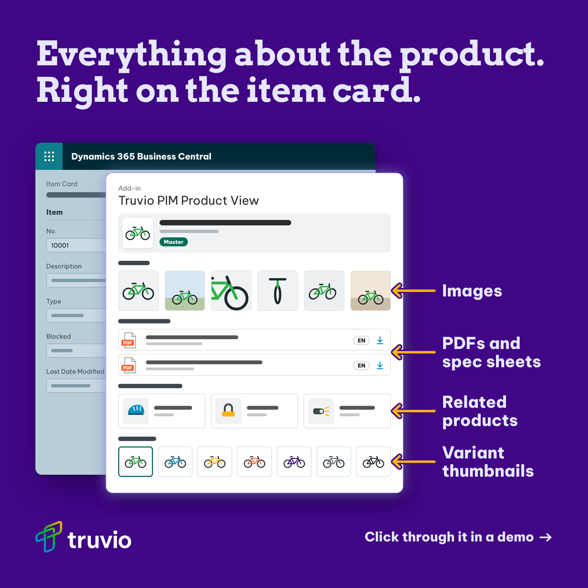
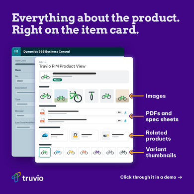

# Handoff: Product View ad (Truvio PIM, LinkedIn)

14 Oct 2026. Work by Grady with Claude. Repo folder: `truvio/pim-ads/product-view/` on branch `claude/peaceful-archimedes-6wot7d` (grxu/grxu).

## Where it stands
- A 1:1 layout comp exists, with Illustrator files. The Product View in it is a drawn stand-in, not the real screenshot.
- No Higgsfield plate. Grady chose to comp the real screenshot by hand instead.
- The real screenshot doesn't exist yet. The request to the product team is written but not sent. This is the main blocker.
- The landing page link isn't settled. Two PIM URLs are in play across the series.

## Next steps
1. Grady sends the product team the message in `product-view.md` (section "Message to send"). It asks for one capture with all four elements and a date.
2. Product team confirms whether images, PDFs, related products and variant thumbnails can show in one view. If not, Grady picks a stitched composite (product team signs it off) or arrows on the Variants and Relations tabs.
3. Grady opens `product-view-1x1.ai` (or the .svg), replaces the `Screenshot_standin` group with the capture, and moves labels and arrow tips to the real rows. Rules in `product-view.md`, section "When the real screenshot lands".
4. Grady swaps Arvo Bold for Museo Slab in the hook and places the official lockup asset.
5. Digital team confirms the PIM URL for both PIM ads before they run.

## Open items

| Item | Who | Why it matters |
|---|---|---|
| Clean Product View screenshot with sample data | Product team (Grady sends the request) | The ad's hero. Nothing ships without it. |
| Can all four elements show in one view? | Product team | The repo's reference screenshot only shows the Assets tab. Decides between one capture, a composite, or arrows on tabs. |
| Is the Mongoose demo item cleared for public use? | Product team | Mongoose is a real bike brand. The messy item card ad shows the same product name. |
| Avatar in the BC header | Product team | The reference screenshot shows a person's photo top right. It must not appear in the capture. |
| One PIM URL for the series | Digital team | This ad uses `/products/business-central/pim`. The messy item card file uses `/products/commerce/product-information-management`. Neither was checked: truvio.com is blocked from the cloud session. |
| PIM landing page is WIP | unknown, ask Grady | The ad links to a placeholder page until it ships. |

## Copy (final, from the brief)
- Visual direction: A real screenshot of the Product View on the BC item card (ask the product team for a clean one with sample data). Four arrows pointing to the key elements: images, PDFs, related products and variant thumbnails. Keep the screenshot large and readable on mobile.
- Hook: Everything about the product. Right on the item card.
- Arrow labels: Images / PDFs and spec sheets / Related products / Variant thumbnails
- Bottom: Click through it in a demo →
- Ads Headline: Click through the Product View in BC
- Ads Body: Images, PDFs, related products and variant thumbnails, right on the BC item card. Click through the Product View yourself in a demo.
- Link: A PIM landing page, currently WIP. we can refer to https://truvio.com/products/business-central/pim for now.

## Decisions

Grady chose (12 Oct 2026):
- No Higgsfield plate. Higgsfield can't draw real UI, and the brief asks for a real screenshot. Everything is comped by hand.
- Spec one capture from the product team showing all four elements. The composite and arrows-on-tabs options stay as fallbacks.
- 1:1 only, matching the messy item card ad. No 4:5.
- Link: this brief's URL for now.

Grady chose (14 Oct 2026):
- The digital team settles one PIM URL for the series.

Claude's calls (not reviewed yet):
- Hook at 62px, down from the series' 66px. At 66px the first line runs 995px wide and crosses the right margin.
- Crop to the panel plus a strip of item card. The full item card at 1080px shrinks the UI past reading on a phone.
- Arrows in Yellow Gold (hex #FFB310) over a Deep Violet keyline, so the tips read where they land on the white panel.
- Labels at 30px, up from the series' 22px label size, for phone reading. CTA kept at the series' 24px.
- Panel rows reordered to the brief's label order. The first build had variants above related products.
- Image thumbnails redrawn as whole-bike views. The first build used cropped details that read as abstract glyphs.

## What was made
The 1:1 comp. Hook, labels, arrows, CTA and lockup are the layout to keep. The BC item card and Product View panel are a drawn stand-in for the screenshot.

The same comp at 390px, phone feed width.

Stand-ins to replace:
- The whole `Screenshot_standin` group (grey-bar UI, drawn bikes, PDF icons, accessories) becomes the real capture.
- Arvo Bold stands in for Museo Slab in the hook.
- Be Vietnam Pro stands in for Segoe UI inside the UI.
- The lockup is rendered from the official Truvio_logo_white.svg. Place the official asset anyway.

## Files

| File | What it is |
|---|---|
| `product-view.md` | Decisions, layout spec, screenshot spec, message to the product team, brand check, QA. Read this second. |
| `product-view-1x1.png` | The comp at 1080x1080. Stand-in screenshot. |
| `product-view-1x1@2x.png` | The comp at 2160x2160. |
| `product-view-1x1-phone-390.png` | The comp at 390px, for the mobile check. |
| `product-view-1x1.svg` | Editable Illustrator master. Named groups, live text, vector lockup. |
| `product-view-1x1.ai` | PDF-based Illustrator file of the same artwork. Fonts embedded, Arvo in place of Museo Slab. |
| `source/product-view.html` | The mock that renders the PNGs and exports the Illustrator files. |
| `source/mock-base.html` | The skill's empty base template. Not used by this ad. |
| `source/fonts/` | Arvo Bold and Be Vietnam Pro (open licence), with licence files. |
| `source/assets/` | Reversed lockup, PNG and SVG, from the official white logo. |

## How to edit
- Quickest: open `product-view-1x1.ai` or `product-view-1x1.svg` in Illustrator, then Save As .ai once to get a native file.
- Re-render from the repo root (repo paths): `.claude/skills/truvio-higgsfield-ad/scripts/render_mock.sh truvio/pim-ads/product-view/source/product-view.html truvio/pim-ads/product-view/product-view-1x1 1080x1080 --accent FFB310`
- Re-export Illustrator files (repo path): `.claude/skills/truvio-higgsfield-ad/scripts/export_svg.py truvio/pim-ads/product-view/source/product-view.html truvio/pim-ads/product-view/product-view-1x1 1080x1080`
- Labels and arrows follow their rows automatically in the HTML. Edit the panel and they move with it.
- Rules to keep: flat Deep Violet ground, 65px safe margin, hook two lines max, no new on-canvas words without sign-off.

## QA results
- Canvas 1080x1080. Light ink inside the 65px safe margin: 0.
- Ground #400685 at two clear sample points. The third lands on the item card.
- Arrow ink #FEB210 against #FFB310.
- Hook ends 80px from the right edge and clears the BC bar by 63px. Widest label ends 86px from the edge. Panel clears the lockup row by 52px.
- At 390px: hook 22px, labels 11px, CTA 9px, image thumbnails 27px. Hook, labels, CTA and BC header read.
- SVG against the mock: mean difference 2.4 per pixel, 0.75 percent of pixels off by more than 60, on antialiased edges.
- .ai fonts: Arvo Bold, Be Vietnam Pro ExtraBold and Regular, all embedded.

## Session log
- 12 Oct 2026: brief received. Grady chose no plate, one spec'd capture, 1:1 only and this brief's link. Comp built, then revised for hook size, thumbnails, label size and row order. Committed as cb6e4e0.
- 14 Oct 2026: Grady confirmed the request isn't sent and the digital team owns the URL. Handoff written.

## Related
- `truvio/pim-ads/messy-item-card/` (repo path): the first PIM ad. Same series layout, glow and house tint. Holds the reference screenshot `truvio/pim-ads/messy-item-card/source/reference-bc-pim.webp`.
- `.claude/skills/truvio-higgsfield-ad/` (repo path): the skill that built the mock and the Illustrator export.
