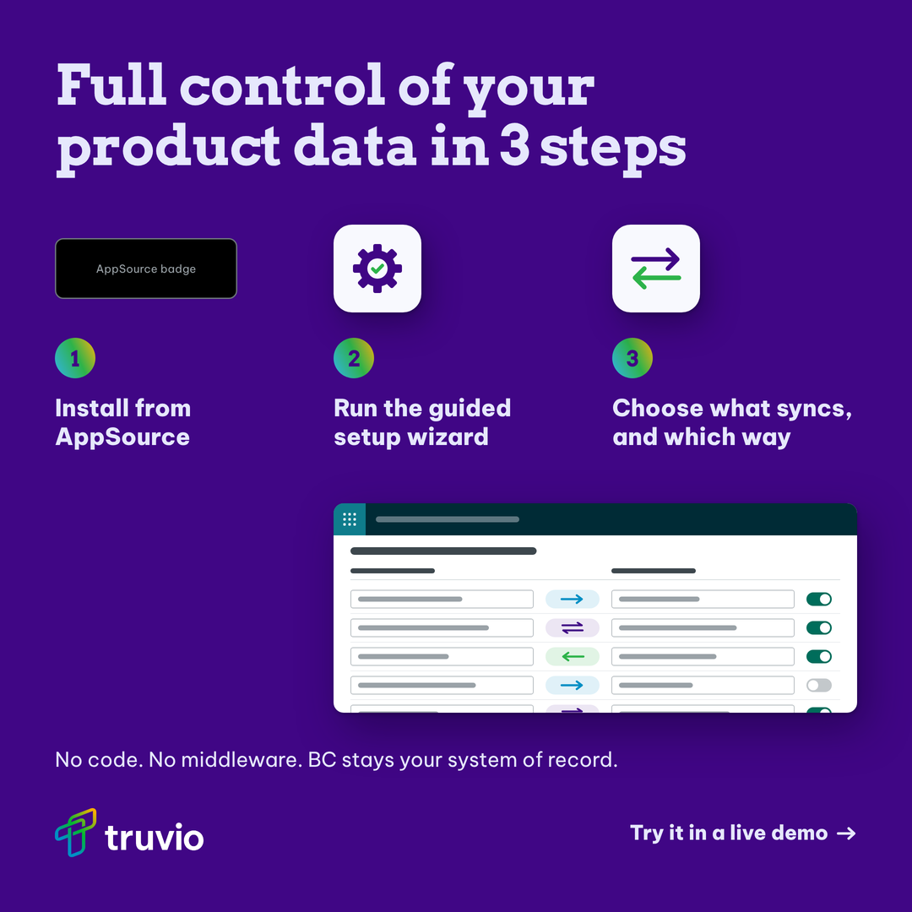
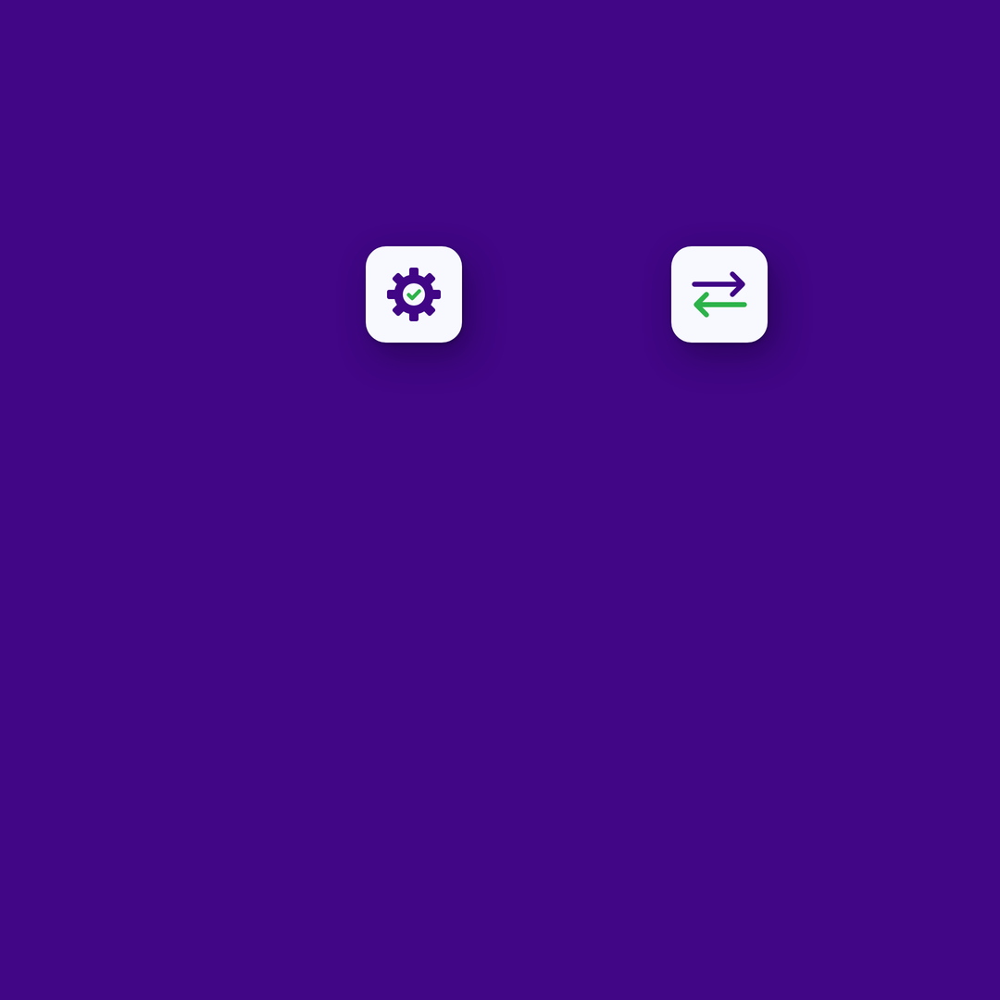

# Handoff: three steps (Truvio PIM ad)

14 Oct 2026. Work by Grady with Claude. Repo folder: `truvio/pim-ads/three-steps/` on branch `claude/gifted-franklin-gsed7s` (grxu).

## Where it stands
- The Higgsfield prompt is written: Prompt A (recommended), Prompt B, a clean plate fallback, a brand check and a fixes list.
- A flat layout mock and a text-free plate reference are rendered at 1080x1080.
- Nothing has been generated in Higgsfield yet.
- Three inputs are missing before the comp can finish: the mapping screen screenshot, the final link, and the AppSource badge file.

## Next steps
1. Grady sends a screenshot of the mapping screen. Claude rebuilds it flat in the mock, like the BC card in the messy item card.
2. Run Prompt A in Nano Banana Pro at 1:1, 2K, batch 4, with `plate-reference-1x1.png` attached as the reference image.
3. Pick the best pair of tiles and check it against the brand check in the prompt file. Run the fixes list on a miss. After two bad batches, use the clean plate option.
4. Cut the tiles out with their shadows and lay them on a flat #400685 fill.
5. Comp the rest by hand: hook and numerals in Museo Slab, step text, footer, CTA, official lockup, official AppSource badge, mapping screen.
6. Product team checks the mapping crop. Confirm the link and the AppSource listing, then publish.

## Open items

| Item | Who | Why it matters |
|---|---|---|
| Mapping screen screenshot | Grady | The mock shows a stand-in with grey bars. The ad headline invites people to try the real mapping. |
| Final link | Grady, digital team | This brief links to https://truvio.com/products/business-central/pim. The messy item card links to https://truvio.com/products/commerce/product-information-management. The PIM landing page is still in progress. Neither URL was checked: truvio.com was blocked from the session. |
| AppSource listing and badge file | Whoever owns the AppSource listing | Step 1 tells people to install from AppSource. The listing has to be live, and the badge has to be Microsoft's official file. |
| Mapping crop sign-off | Product team | Real product UI in a paid ad. |
| Claude's layout calls | Grady | The calls listed below under "Claude's calls" are not reviewed yet. |

## Copy (final, from the brief)
- Hook: Full control of your product data in 3 steps
- Steps: 1 Install from AppSource. 2 Run the guided setup wizard. 3 Choose what syncs, and which way
- Footer: No code. No middleware. BC stays your system of record.
- CTA on design: Try it in a live demo →
- Ads headline: Try the field mapping yourself in a demo
- Ads body: Install from AppSource, run the setup wizard, choose what syncs where. Your BC users own the mapping. Try it yourself in a live demo.
- Visual direction from the brief: clean numbered layout, three steps, a small icon per step (AppSource logo style, wizard or setup, two-way sync arrows), an optional small cropped screenshot of the mapping screen in the background, the reassurance line at the bottom.

## Decisions

Grady chose (12 Oct 2026):
- Higgsfield makes the full plate. The badge and the mapping screen are placed by hand, so the plate ends up holding the violet ground and two icon tiles only.
- Step 1 uses Microsoft's official AppSource badge, placed by hand. Claude flagged the "AppSource logo style" icon from the brief: Nano Banana distorts logos, and a look-alike of a Microsoft mark is a risk in a paid ad.
- The mapping screen is the real screen, rebuilt flat from a screenshot.
- 1:1 only, same as the messy item card.

Claude's calls (not reviewed yet):
- Three columns instead of a vertical list. The badge is wide (216x72 stand-in). In a list it pushes the step text right and leaves no room for the mapping crop.
- A settings cog with a green tick for step 2, not a wand with sparkles. Sparkles read as AI and would suggest AI runs the setup.
- Two straight arrows pointing opposite ways for step 3, not circular sync arrows. A circle reads as refresh. Straight arrows show the "which way".
- Glyphs in Deep Violet #400685 with Electric Green #2DB34A. Tiles in off-white #F8F9FE.
- Numbers in 48px circles filled with the secondary gradient at 25.4 degrees, an echo of the gradient underline in the messy item card.
- The mapping card stays white at full strength. A 34 percent violet tint was tested and read lilac and muddy at feed size.
- Prompt A (matte letterpress card tiles) over Prompt B (glossy porcelain and enamel). B pops more and reads closer to the generic 3D icon look.

## What was made

Layout mock. The black badge and the grey-bar mapping card are stand-ins.

Plate reference. Attach it in Higgsfield to lock the tile positions.

## Files

| File | What it is |
|---|---|
| `higgsfield-prompt-three-steps.md` | The prompt file: copy, decisions, layout, settings, Prompts A and B, clean plate option, brand check, avoid list, fixes. |
| `three-steps-1x1.png` | The layout mock at 1x. |
| `three-steps-1x1@2x.png` | The layout mock at 2160x2160. |
| `plate-reference-1x1.png` | The mock with only the two tiles showing. The Higgsfield reference image. |
| `source/three-steps.html` | The mock source. Arvo Bold stands in for Museo Slab. |
| `source/plate-reference.html` | The same mock with `body class="plate"`, which hides everything set by hand. |
| `source/fonts/` | Arvo Bold and Be Vietnam Pro Regular and ExtraBold, with their OFL licences. |
| `source/assets/` | The reversed lockup, rendered from the official Truvio_logo_white.svg. Place the official asset in the comp. |

## How to edit the mock
- Quick look: open `source/three-steps.html` in Chrome with the window at 1080x1080.
- Render with QA, from the grxu repo: `.claude/skills/truvio-higgsfield-ad/scripts/render_mock.sh truvio/pim-ads/three-steps/source/three-steps.html truvio/pim-ads/three-steps/three-steps-1x1 1080x1080`
- Rebuild the plate reference after any layout change: `sed 's#<body>#<body class="plate">#' source/three-steps.html > source/plate-reference.html`, then render it the same way.
- Illustrator files on request: `.claude/skills/truvio-higgsfield-ad/scripts/export_svg.py`.

## QA results
- Canvas 1080x1080, light ink inside the 65px safe margin: 0, in both renders.
- Ground #400685 at all three sample points, in both renders.
- Fonts loaded: Arvo Bold, Be Vietnam Pro Regular and ExtraBold.
- The hook clears the tiles by 58px. The step text clears the mapping card by 62px. The mapping card clears the footer by 40px.
- "Choose what syncs," fills its 290px column exactly, with no overflow.

## Session log
- 12 Oct: brief received. Claude read the brand spec, voice rules and the messy item card folder, then asked four intake questions (above).
- 12 Oct: mock v1 rendered. A dimmed mapping card was tested and dropped. The cog was redrawn as a standard eight-tooth cog, and both glyphs were sized to about 60 percent of the tile.
- 12 Oct: prompt file written and pushed in commit 6bb053e.
- 14 Oct: this handoff and the zip packed.

## Related
- `truvio/pim-ads/messy-item-card/`: the first ad in the PIM campaign. Same ground, hook style, CTA and lockup placement.
- `.claude/skills/truvio-higgsfield-ad/`: the skill that wrote the prompt and rendered the mock.
