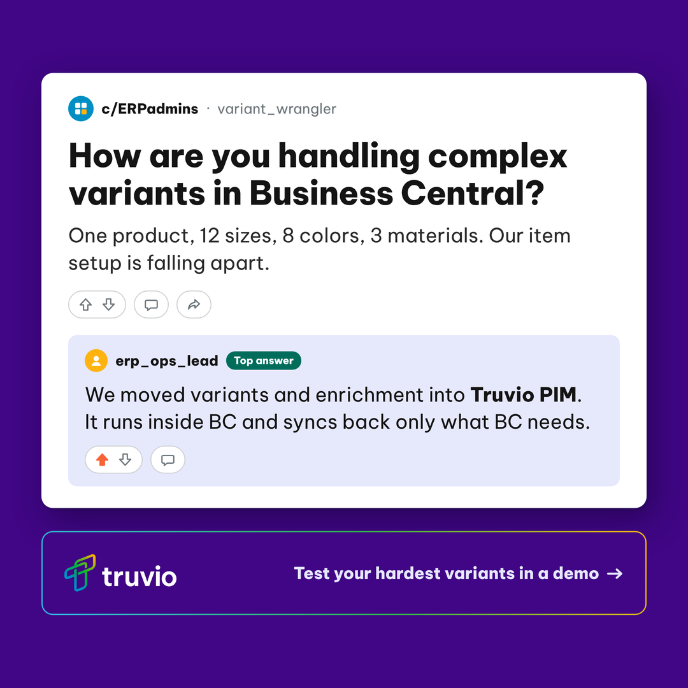
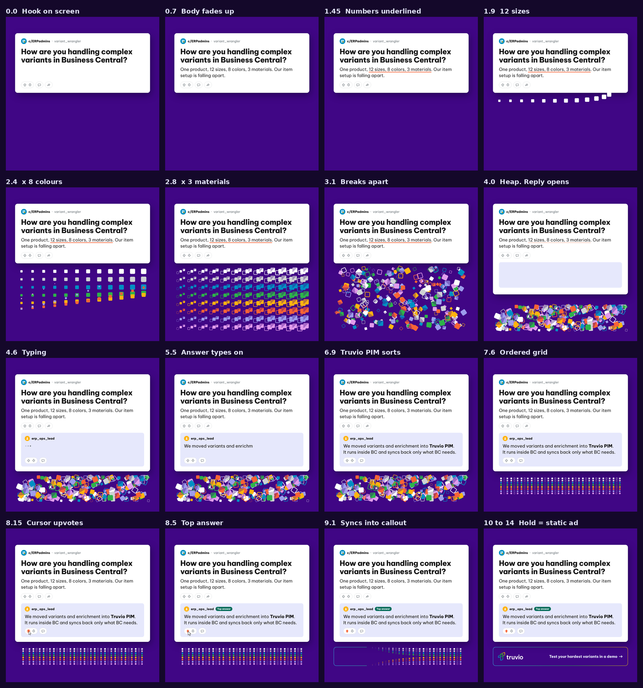
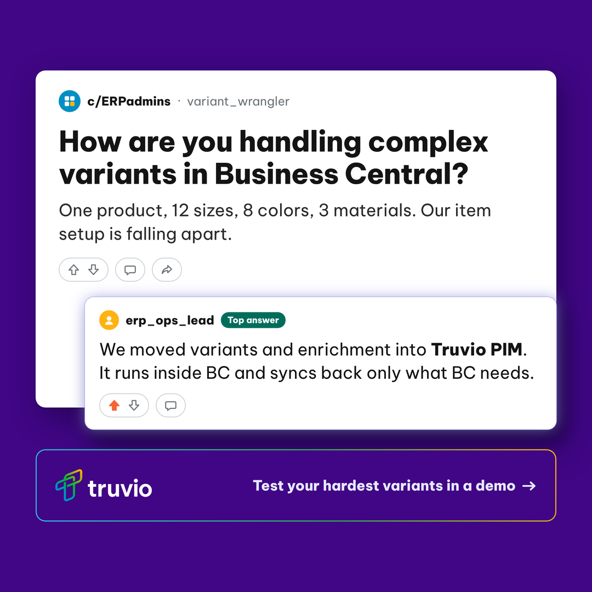

# Handoff: Variants thread (Truvio PIM LinkedIn ads)

14 Oct 2026. Work by Grady with Claude. Repo folder: `truvio/pim-ads/variants-thread/` on branch `claude/vibrant-maxwell-w3i1yc` (grxu/grxu).

## Where it stands
- The static ad is laid out as a flat HTML mock and exported to Illustrator (`variants-thread-flat-1x1.ai` and `.svg`). Grady chose the flat layout on 14 Oct.
- A Higgsfield prompt file is ready, but nothing has been generated in Higgsfield yet.
- A 14-second animation is fully specified for an After Effects ExtendScript build, with an animatic MP4 of the motion that Grady hasn't reviewed yet. The AE script hasn't been written yet. Grady will hand the brief to another Claude account.
- New on-canvas names and animation elements are waiting on Grady's sign-off, and the interim landing page link is unchecked.
- Nothing has been published.

## Next steps
1. Grady: watch `animation/variants-thread-animatic.mp4` and sign off the new elements listed under Open items.
2. Grady: finish the static ad from `variants-thread-flat-1x1.ai` in Illustrator. Swap in the official reversed lockup and Save As .ai once to get a native file. If he wants an AI-rendered pass, run Prompt B in `higgsfield-prompt-variants-thread.md` with `variants-thread-flat-ref@2x.png` attached.
3. Other Claude account: read `animation-variants-thread.md` from top to bottom and write `animation/variants-thread-build.jsx`. Everything it needs is in `animation/`.
4. Grady: run the `.jsx` in After Effects from the `animation/` folder, then work through the QA list in `animation-variants-thread.md`. Render `variants-thread-1x1.mp4`.
5. Grady: check https://truvio.com/products/business-central/pim loads, then upload the video with `variants-thread-flat.png` as its LinkedIn thumbnail.

## Open items

| Item | Who | Why it matters |
|---|---|---|
| Sign off c/ERPadmins, variant_wrangler, erp_ops_lead and the Top answer tag | Grady | None of them is in the brief. Search all three names on Reddit first, so none points to a real account or community |
| Sign off the animation's typing dots, red underline, variant tiles and burst rays | Grady | New elements on the canvas. The cursor is already approved |
| Check https://truvio.com/products/business-central/pim loads | Grady | The PIM landing page is still in progress. The item card ad used /products/commerce/product-information-management, so the two PIM ads link to different URLs |
| Static route: Illustrator .ai or Higgsfield Prompt B | Grady | The .ai is close to final already. A Higgsfield pass only adds a rendered finish |
| AE script not yet written or run | Other Claude account, then Grady | Claude can't open AE, so the first run is the first real test of the build |
| Two accent colours in the tiles (Twilight, Celestial Bloom) | Grady | The brand spec allows accents on screen in limited use. They are gone by the hold frame |

## Copy (final, from the brief)
Visual direction: "A Reddit style post in a Dynamics/ERP themed community, with an upvoted top answer. Use generic, fictional usernames and don't mimic a real subreddit name too closely. Truvio callout box below the thread."

- Post title: How are you handling complex variants in Business Central?
- Post body: One product, 12 sizes, 8 colors, 3 materials. Our item setup is falling apart.
- Top answer: We moved variants and enrichment into Truvio PIM. It runs inside BC and syncs back only what BC needs.
- Callout: Test your hardest variants in a demo →
- Ads headline: Test your hardest variants in Truvio PIM
- Ads body: Dozens of sizes, colors and specs per product? Truvio PIM structures variants properly and syncs the right data back to BC. Test yours in a demo.
- Link: "A PIM landing page, currently WIP. we can refer to https://truvio.com/products/business-central/pim for now."

## Decisions

Grady chose (12 Oct):
- Nano Banana Pro writes the thread copy and leaves the callout box empty. Grady sets the lockup and CTA in the comp.
- Upvote signal: a filled Prometheus Red (#F76336) arrow plus a Top answer tag. No vote counts or other numbers, because a count would be an invented figure that reads as real social proof.
- 1:1 only (1080x1080), same as the item card ad.
- Link /products/business-central/pim, as briefed.

Grady chose (14 Oct):
- Flat layout for the static ad and the animation. The lift option (answer card floating out with a Twilight glow) was mocked and dropped.
- Export the flat option to Illustrator.
- Animation built in After Effects by script, not Higgsfield. AI video warps letters, and this ad is about 45 words of exact copy.
- Full animation scope: the thread plus the variant explosion.
- A plain pointer cursor clicks the upvote.
- Grady signs off the new names and elements, and checks the link.

Claude's calls (not reviewed yet):
- Community and usernames: c/ERPadmins (c/ keeps the forum look without Reddit's r/), variant_wrangler, erp_ops_lead.
- No separate headline. The post title is the hook.
- The lockup sits inside the callout box with the CTA, not bottom left.
- Truvio PIM is set in bold inside the answer. The words are unchanged.
- No Museo Slab on this canvas. The thread uses Be Vietnam Pro as forum UI type, and the CTA is Be Vietnam Pro ExtraBold.
- Top answer tag in Teal Meridian (#006D5B), matching the Master tag in the item card ad. Answer panel in #E6E8FC.
- Callout outline: a 2px secondary gradient at 25.4 degrees on Deep Violet.
- Type sizes: title 52px, body and answer 31px, names 22px, CTA 26px.
- Animation design: 14 seconds, 288 tiles (12 x 8 x 3), the red underline, typing dots, burst rays, the heap, the sorted grid and all timings.
- Tile colours: White, Silver, Celestial Blue, Electric Green, Yellow Gold, Prometheus Red, Twilight, Celestial Bloom. Materials drawn as solid, outline and a split tile.

## What was made

The static ad, flat layout (chosen). Be Vietnam Pro stands in for the forum app's UI type. The lockup is rendered from the official white SVG, but place the official asset in the final.

The animation's 16 beats, from the HTML animatic. The animatic is a preview of the motion, not the final video. AE renders the final.

The dropped lift option, kept for reference.

## Files

| File | What it is |
|---|---|
| `handoff-variants-thread.md` | This file |
| `higgsfield-prompt-variants-thread.md` | Higgsfield prompt file: copy, decisions, Prompt A (lift, dropped) and Prompt B (flat, chosen), brand check, fixes |
| `animation-variants-thread.md` | Build brief for the AE ExtendScript. Read this before writing the `.jsx` |
| `variants-thread-flat.png`, `variants-thread-flat@2x.png` | Flat mock, 1080 and 2160. Final layout, stand-in fonts and lockup |
| `variants-thread-flat-1x1.ai` | Flat layout as a PDF-based Illustrator file. Live text, vector except the card shadow |
| `variants-thread-flat-1x1.svg` | Flat layout as a layered SVG with named groups. The editable master |
| `variants-thread-flat-ref.png`, `@2x` | Flat mock with the lockup and CTA hidden. Higgsfield reference image for Prompt B |
| `variants-thread-lift.png`, `@2x`, `variants-thread-lift-ref.png`, `@2x` | Lift option and its reference. Dropped |
| `source/variants-thread-flat.html`, `source/variants-thread-lift.html` | HTML mocks. `-ref.html` versions hide the lockup and CTA |
| `source/thread.css` | Shared styles for the mocks |
| `source/fonts/` | Arvo Bold and Be Vietnam Pro (Regular, ExtraBold), open licence, licences included. Arvo isn't used on this canvas |
| `source/assets/` | Reversed lockup as PNG (1170x387) and SVG, from the official white logo |
| `animation/variants-thread-animatic.mp4` | The motion target, 1080x1080, 30 fps, 14 s, 420 frames |
| `animation/storyboard.png` | 16 labelled frames from the animatic |
| `animation/vt-data.js` | All keyframes: UI tracks, 288 tiles, AE path data for every icon. Generated, never hand-edit |
| `animation/build_data.py` | Generates `vt-data.js` and `callout-gradient.png` from a fixed seed |
| `animation/callout-gradient.png` | Gradient plate for the callout outline, used through a track matte in AE |
| `animation/animatic.html` | HTML animatic. `renderAt(seconds)` draws any frame |
| `animation/render_animatic.mjs` | Renders the animatic to MP4 with Playwright and ffmpeg |

## How to edit
- Static: open `variants-thread-flat-1x1.ai` in Illustrator, or the `.svg` for named groups.
- Re-render a mock (repo path): `.claude/skills/truvio-higgsfield-ad/scripts/render_mock.sh source/variants-thread-flat.html variants-thread-flat 1080x1080`
- Re-export to Illustrator (repo path): `.claude/skills/truvio-higgsfield-ad/scripts/export_svg.py source/variants-thread-flat.html variants-thread-flat-1x1 1080x1080`
- Change the motion: edit `animation/build_data.py`, run `python3 build_data.py` in `animation/`, then `node render_animatic.mjs` for a new preview (about 30 seconds). It needs Playwright and ffmpeg. Link a Playwright install as `animation/node_modules` or run `npm i playwright` there.
- Single preview frames: `node render_animatic.mjs --frames-only 2.8,7.6` writes PNGs to `animation/frames/`.
- After changing the data, re-run the AE script in a fresh comp.

## QA results
- Mocks: light ink inside the 65px safe margin 0 in all four renders. Ground #400685 at the clear sample. Upvote ink #F76336 exactly. Title, body and answer each two lines, no widows.
- Illustrator export: SVG rendered back against the mock, mean difference 1.65 per pixel, 0.53 percent of pixels off by more than 60, all on text edges from sub-pixel tracking. Both Be Vietnam Pro weights embedded as live text in the .ai.
- Icon path data for AE: redrawn as SVG, zero differing pixels against the original paths.
- Animatic: last frame against a 1x render of the static mock, mean difference 0.96 per pixel. The rest is antialiasing, a 1px kerning shift from the per-letter type-on and the outline's edges.
- Tiles never cross the 65px safe margin (asserted in `build_data.py`). The heap's top stops at y 815.6, clear of the card bottom at 797.

## Session log
- 12 Oct: Brief in. Intake questions answered (thread copy by Nano Banana, upvote signal, 1:1, link). Flat and lift mocks built, lift recommended. Prompt file written. Commit be14e64.
- 14 Oct: Flat exported to Illustrator. The exporter's icon colour bug was fixed in the skill's `svg_walker.js` (repo path `.claude/skills/truvio-higgsfield-ad/scripts/svg_walker.js`). Commit f25fc57.
- 14 Oct: Animation direction chosen (AE script, flat throughout, variant explosion, cursor). Data generator, animatic, storyboard and AE build brief made. Higgsfield video was ruled out for this ad, because AI video warps exact copy. Commit 2957376.
- 14 Oct: Grady chose flat for the static. Prompt file updated to match. Handoff written.

## Related
- `truvio/pim-ads/messy-item-card/`: the other PIM ad in this campaign. Same violet ground, Teal Meridian tag and lockup treatment. It links to the older interim URL.
- `.claude/skills/truvio-higgsfield-ad/` (repo path): the skill that made the prompt file, mocks and Illustrator export.
- `.claude/skills/truvio-higgsfield-ad/references/video-prompts.md` (repo path): why Higgsfield video was ruled out for text-heavy frames.
