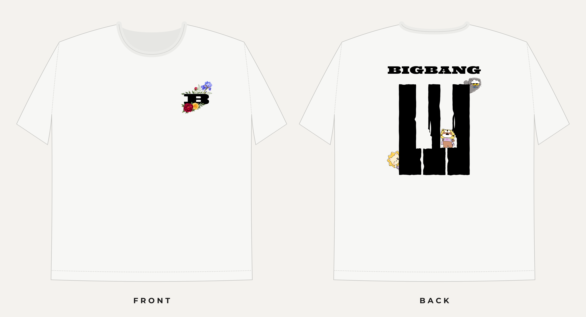

# BIGBANG SG concert tee: White tee (final)

A fan-made T-shirt for a BIGBANG concert in Singapore, for personal use and
friends. This zip holds the **white-tee** colourway: print-ready files, a
mockup and the vendor spec sheet. A separate black-tee zip has the same
layout in the other colourway.

## The design

- **Front:** a 10 × 10 cm emblem on the wearer's left chest. A black slab
  "B" sits in the letter shape of the back wordmark (font: Ultra, stretched
  1.6×). It has a thin white outline gap
  against the watercolour flowers. A blue iris spray with fern rises at the
  top right. A red peony and a yellow rose hug the bottom of the B,
  overlapping it slightly, nudged left. The layout is asymmetric on purpose:
  the supervisor didn't want it symmetrical.
- **Back:** a 27.75 × 31.7 cm piece, centred. The BIGBANG wordmark in black
  sits over three hand-brushed black piano keys, closely modelled (~80%) on
  a reference sticker: chipped edges, flared black keys with "dagger"
  slivers. Three cartoon characters peek around the keys (added by Grady in
  Illustrator) and stay full colour.
- **Shirt colour in the mockup:** #f7f7f5.

## Files

| File | Use |
|---|---|
| `FRONT_left-chest_100x100mm_white-tee.ai` / `.pdf` | Front artwork, 10 × 10 cm artboard, transparent background. Vector B and two placed watercolour images at full resolution (~980 dpi at print size). The .ai and .pdf are identical. |
| `FRONT_..._300dpi.png`, `FRONT_..._hires.png` | Transparent renders at 300 dpi (print size) and 900 dpi. |
| `BACK_277.5x317.4mm_white-tee.ai` / `.pdf` | Back artwork, all vector (wordmark, keys, characters), transparent background. |
| `BACK_..._300dpi.png` | Transparent render at 300 dpi. |
| `mockup_white-tee.png` | Front + back on a white tee. |
| `spec-sheet_white-tee.pdf` / `.png` | A3 vendor sheet: sizes, placement, print notes. |

## Print spec (for the vendor)

- **Garment:** white cotton tee, oversized / drop-shoulder.
- **Method:** DTF or DTG, full colour (the flowers and characters are
  multicolour).
- **Front placement:** left chest, emblem left edge 8 cm from the centre
  line, top edge 7.5 cm below the centre-front collar seam.
- **Back placement:** centred, top 10 cm below the centre-back collar seam.
- **Background:** the background is transparent everywhere. Print only the
  artwork, never a background box.
- **Colours and text:** sRGB, and all text is outlined (no fonts needed).

## How these files were made (context for whoever picks this up)

- The flowers are AI watercolours (Nano Banana Pro via Higgsfield). The white
  background was cut out and a straight edge left by the generator was
  softened. They are placed as two separate images: the iris spray, and the
  peony + rose.
- Grady laid out the final composition and added the characters in Adobe
  Illustrator. The raw files are in the repo under `tshirt-bigbang-sg/final-raw/`.
- `src/invert_final.py` in the repo makes both colourways from those raw
  files by editing the vector content directly:
  - it removes the background rectangles;
  - for the white tee only, it recolours the B, wordmark and keys black and
    turns the B's black outline stroke white;
  - it swaps Illustrator's downsampled (~300 dpi, JPEG) flower images for
    the lossless full-res originals at identical placement.
- The .ai files are **PDF-compatible**, so Illustrator opens and edits them.
  File → Save As → Adobe Illustrator (.ai) makes them fully native. On the
  back, Illustrator's private data block was removed so the edits show. It
  opens from the PDF content, so the original layer setup may come in
  simplified.
- Repo: `grxu/grxu`, branch `claude/brave-edison-i18pzh`, folder
  `tshirt-bigbang-sg/`.

## Rights note

"BIGBANG" and any official character artwork belong to their owners. This is
fine for personal or fan use. Selling the shirts would need permission. The
fonts are licensed for this use (Ultra: Apache 2.0; Montserrat: SIL OFL, used
only on the spec sheet).

## Open items

- Get the vendor's file preference (.ai / .pdf / .png) and confirm sizes per
  shirt size.
- Approve this white-tee version with the supervisor.
